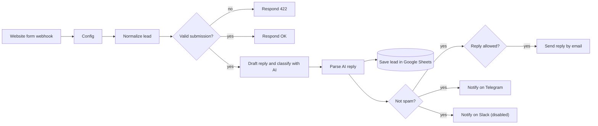

# 01 Website form to CRM with AI reply

A visitor submits your contact form. Within seconds the lead is saved in a Google Sheet, your team gets a Telegram (or Slack) message with an AI summary, and the visitor receives a short personal reply in their own language.



## What it does

1. **Webhook** receives a JSON `POST` from your form.
2. **Normalize lead** trims and limits every field and reads a honeypot field (`_gotcha`).
3. **Valid submission?** requires a valid email, a message and an empty honeypot. Invalid submissions get a `422` and stop.
4. **Respond OK** answers the browser immediately, so the visitor never waits for the AI.
5. **Draft reply with AI** writes the reply and classifies the enquiry (sales, support, partnership, spam, other) with an urgency level and a one-line summary for your team.
6. **Parse AI reply** validates the model output. If the AI failed, the lead is kept with category `unclassified` and no reply.
7. **Save lead in CRM** appends a row to the `Leads` tab. It runs for every lead, spam included, so you can audit what was filtered.
8. For non-spam leads: a Telegram message to your team, and, if `auto_send_reply` is `true` and a reply was drafted, the email to the lead.

## Credentials you need

| Node | Credential | Notes |
|---|---|---|
| Draft reply with AI | OpenAI API (or compatible) | Any OpenAI-compatible provider, see `ai_base_url` |
| Save lead in CRM | Google Sheets OAuth2 | |
| Send reply to lead | SMTP | Works with any mailbox, including Google Workspace app passwords |
| Notify team on Telegram | Telegram API | Bot token from @BotFather |
| Notify team on Slack | Slack API | Disabled by default |

## Config node

| Field | Example | Meaning |
|---|---|---|
| `model` | `gpt-4o-mini` | Any chat model on your provider that supports JSON mode |
| `ai_base_url` | `https://api.openai.com/v1` | Base URL of the OpenAI-compatible API |
| `from_email` | `Your Company <hello@your-company.example>` | Sender of the reply |
| `auto_send_reply` | `true` | `false` = notify only, no email to the lead |
| `sheet_id` | `YOUR_GOOGLE_SHEET_ID` | The ID from the spreadsheet URL |
| `telegram_chat_id` | `YOUR_TELEGRAM_CHAT_ID` | Chat or channel that receives alerts |
| `slack_channel_id` | `YOUR_SLACK_CHANNEL_ID` | Only used if you enable the Slack node |
| `system_prompt` | long text | Replace the text in [square brackets] with your company description |

## Sheet

Create a tab named `Leads` and import [`sheets/leads.csv`](sheets/leads.csv) as the header row:

`Received at, Name, Email, Phone, Company, Message, Page, Category, Urgency, AI summary, AI status`

## Import and set up

See the [main README](../README.md#import-a-template). In short: import `workflow.json`, fill `Config`, choose credentials, create the `Leads` tab, set the webhook's allowed origin to your website's address, activate.

## Test it

Use the test URL while the workflow is open in the editor (`Listen for test event`):

```bash
curl -X POST "https://YOUR-N8N-HOST/webhook-test/website-lead" \
  -H "Content-Type: application/json" \
  -d '{
    "name": "Maria Ionescu",
    "email": "maria@example.com",
    "phone": "+1 555 0100",
    "company": "Example SRL",
    "message": "Hello, I would like a quote for a website for our restaurant.",
    "page": "/contact",
    "_gotcha": ""
  }'
```

Once active, the same request goes to `/webhook/website-lead`.

## Connect your form

```html
<form id="contact">
  <input name="name" required>
  <input name="email" type="email" required>
  <input name="phone">
  <textarea name="message" required></textarea>
  <!-- honeypot: hidden from people, bots fill it in -->
  <input name="_gotcha" tabindex="-1" autocomplete="off" style="position:absolute;left:-9999px" aria-hidden="true">
  <button>Send</button>
</form>
<script>
  document.getElementById('contact').addEventListener('submit', async (event) => {
    event.preventDefault();
    const data = Object.fromEntries(new FormData(event.target));
    data.page = location.pathname;
    const res = await fetch('https://YOUR-N8N-HOST/webhook/website-lead', {
      method: 'POST',
      headers: { 'Content-Type': 'application/json' },
      body: JSON.stringify(data),
    });
    event.target.reset();
    alert(res.ok ? 'Thank you, we will be in touch.' : 'Something went wrong, please try again.');
  });
</script>
```

The webhook's allowed origin (an option on the Webhook node) must match your site, otherwise the browser blocks the request.

## Customise

- **HubSpot or another CRM instead of Sheets:** delete `Save lead in CRM` and add the CRM node (for HubSpot: Contact, Create or Update, keyed on email) connected to `Parse AI reply`. Nothing else depends on the Sheets node.
- **Review before sending:** set `auto_send_reply` to `false`, or replace `Send reply to lead` with a Gmail node that creates a draft.
- **Tone, language and rules:** edit `system_prompt`. Keep the JSON keys in the last paragraph unchanged, the Code node reads them.
- **More fields:** add them in `Normalize lead`, to the prompt text in the AI node and to the column mapping of the Sheets node.

## Limits

- The reply is only as good as the company description you give the model. Test with real enquiries, in every language you receive, before you switch auto-send on.
- The prompt forbids prices and promises, but an AI reply is still an AI reply. Keep a human review step for high-value enquiries if that matters for your business.
- Personal data is sent to your AI provider. See the privacy notes in the main README.
