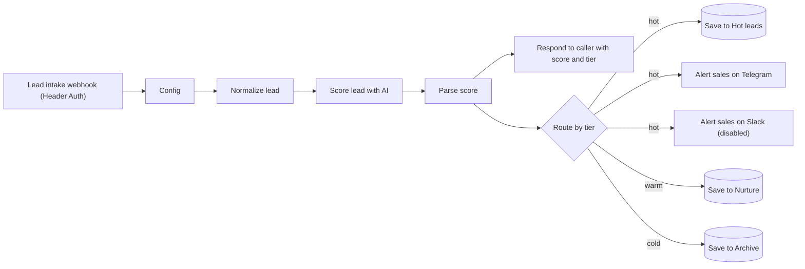

# 02 AI lead scoring and routing

A new lead arrives from any source that can send an HTTP request. The AI scores it from 0 to 100 against your ideal customer profile, code turns the score into a tier, and the lead is routed: hot leads trigger an instant alert, warm leads go to a nurture list, cold leads go to an archive.



## What it does

1. **Lead intake webhook** accepts a JSON `POST` protected by a Header Auth credential.
2. **Normalize lead** reads the fields below and limits their length.
3. **Score lead with AI** applies a rubric from the system prompt: fit with your ideal customer (40 points), buying intent (30), budget and authority (20), contact quality (10). It also returns intent, budget signal, reasons, red flags and a suggested next action.
4. **Parse score** validates the answer, clamps the score to 0 to 100 and derives the tier from your thresholds (`hot_threshold`, `warm_threshold` in Config). If scoring fails, the lead goes to the middle tier flagged `failed`, so a human reviews it.
5. **Respond to caller** returns `{ ok, score, tier, summary }` to whatever sent the lead, handy for debugging or for the sender to store.
6. **Route by tier** sends the lead to the right tab. Hot leads also trigger a Telegram message (and Slack if you enable it).

## Expected payload

```json
{
  "name": "Maria Ionescu",
  "email": "maria@example.com",
  "phone": "+1 555 0100",
  "company": "Example SRL",
  "job_title": "Operations Manager",
  "country": "Romania",
  "budget": "5000 to 8000 EUR",
  "source": "Meta lead ad",
  "message": "We need a booking site and an automated follow-up for new customers, we want to start next month."
}
```

All fields are optional; missing information lowers the score. Anything that can send an HTTP `POST` with JSON can feed this workflow: a CRM webhook, a form tool, a Zapier or Make step, or another n8n workflow. If your source uses different field names, change the expressions in `Normalize lead`.

## Credentials you need

| Node | Credential | Notes |
|---|---|---|
| Lead intake webhook | Header Auth | For example header `X-Api-Key` with a long random value |
| Score lead with AI | OpenAI API (or compatible) | See `ai_base_url` in Config |
| Save to Hot leads, Nurture, Archive | Google Sheets OAuth2 | |
| Alert sales on Telegram | Telegram API | |
| Alert sales on Slack | Slack API | Disabled by default |

## Config node

| Field | Default | Meaning |
|---|---|---|
| `model` | `gpt-4o-mini` | Chat model with JSON mode |
| `ai_base_url` | `https://api.openai.com/v1` | OpenAI-compatible API |
| `hot_threshold` | `70` | Score at or above = hot |
| `warm_threshold` | `40` | Score at or above (and below hot) = warm, below = cold |
| `sheet_id` | `YOUR_GOOGLE_SHEET_ID` | Spreadsheet that holds the three tabs |
| `telegram_chat_id` | `YOUR_TELEGRAM_CHAT_ID` | Where hot-lead alerts go |
| `slack_channel_id` | `YOUR_SLACK_CHANNEL_ID` | Only if you enable Slack |
| `system_prompt` | long text | Describe what you sell and who your ideal customer is (text in [square brackets]) |

## Sheet

Create three tabs, `Hot leads`, `Nurture` and `Archive`, each with the same header row from [`sheets/scored-leads.csv`](sheets/scored-leads.csv):

`Received at, Name, Email, Phone, Company, Job title, Country, Source, Stated budget, Message, Score, Tier, Intent, Budget signal, Summary, Reasons, Red flags, Next action, Scoring status`

## Test it

```bash
curl -X POST "https://YOUR-N8N-HOST/webhook-test/lead-intake" \
  -H "Content-Type: application/json" \
  -H "X-Api-Key: YOUR_KEY" \
  -d '{"name":"Maria Ionescu","email":"maria@example.com","company":"Example SRL","job_title":"Operations Manager","budget":"5000 to 8000 EUR","message":"We need a booking site and automated follow-up, starting next month."}'
```

The response contains the score and tier. Try a vague one-line message with a free email address to see a cold lead land in `Archive`.

## Customise

- **Your scoring rules:** the rubric is plain text in `system_prompt`. Rewrite the point weights and the ideal customer profile for your business.
- **Hard rules in code:** add checks in `Parse score` (for example force `cold` for free email domains, or `hot` for a named key account) so business rules never depend on the model.
- **Owners and SLAs:** add a field in `Parse score` that assigns an owner per tier (or round-robin with workflow static data) and map it to a new column.
- **Your CRM instead of Sheets:** replace the three Sheets nodes with your CRM's create-or-update node. Hot leads can also create a task or a deal.
- **Trigger from a sheet:** replace the webhook with a Google Sheets Trigger (row added) to score rows created by template 01.

## Limits

- The score is a prioritisation aid, not a verdict. Review a sample of hot and cold leads regularly and tune the prompt.
- The model sees only what is in the payload. It does not look the company up.
- Personal data is sent to your AI provider. See the privacy notes in the main README.
