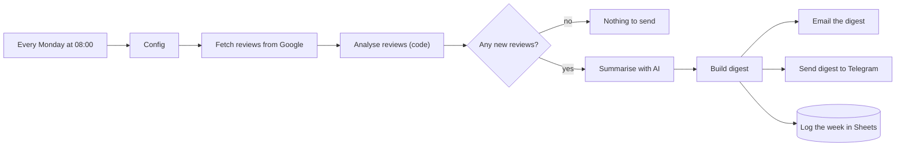

# 03 Google reviews weekly AI summary

Every Monday the workflow pulls the latest Google reviews of a business, keeps the ones from the last week, and sends the owner a short digest: how many reviews, the average rating, what customers praised, what they complained about, anything urgent, and which low-rated reviews still have no reply.

## What it does

1. **Every Monday at 08:00** (in the timezone of the workflow, see Settings) starts the run. Change the schedule in the first node.
2. **Fetch reviews from Google** calls the Google Business Profile API for your location, newest first (up to 50).
3. **Analyse reviews** keeps reviews created in the last `lookback_days`, converts star ratings to numbers and computes the count, average, rating distribution and the list of low-rated reviews without an owner reply. This part is plain code, so the numbers are exact.
4. **Any new reviews?** stops quietly when there is nothing new.
5. **Summarise with AI** receives only rating, date and text (no reviewer names) and returns a headline, overall sentiment, what was praised, complaints, urgent items and up to three suggested actions.
6. **Build digest** combines the exact numbers with the AI summary into one plain-text digest.
7. The digest goes out by email and Telegram, and one row per week is appended to the `Weekly log` tab so you can chart the trend.

## Credentials you need

| Node | Credential | Notes |
|---|---|---|
| Fetch reviews from Google | Google OAuth2 API | Scope `https://www.googleapis.com/auth/business.manage` |
| Summarise with AI | OpenAI API (or compatible) | |
| Email the digest | SMTP | |
| Send digest to Telegram | Telegram API | |
| Log the week in Sheets | Google Sheets OAuth2 | |

### Google Business Profile access

Reading reviews uses the Google Business Profile API, which is not open to everyone by default.

1. In a Google Cloud project, enable the Business Profile APIs (My Business Account Management, Business Information and the reviews API).
2. Request API access for the project from Google and wait for approval.
3. In n8n create a **Google OAuth2 API** credential for that project with the scope above and authorise it with the Google account that manages the business profile.
4. Find your numeric account and location IDs, for example by calling `GET https://mybusinessaccountmanagement.googleapis.com/v1/accounts` and then `GET https://mybusinessbusinessinformation.googleapis.com/v1/accounts/ACCOUNT_ID/locations?readMask=name,title` with the same credential (a temporary HTTP Request node works). Put the two numbers in Config.

## Config node

| Field | Default | Meaning |
|---|---|---|
| `model` | `gpt-4o-mini` | Chat model with JSON mode |
| `ai_base_url` | `https://api.openai.com/v1` | OpenAI-compatible API |
| `business_name` | `Your Business Name` | Used in the digest and the AI prompt |
| `gbp_account_id` | `YOUR_ACCOUNT_ID` | Numeric account ID |
| `gbp_location_id` | `YOUR_LOCATION_ID` | Numeric location ID |
| `lookback_days` | `7` | Reviews newer than this are included |
| `low_rating_max` | `3` | Ratings up to this value are listed when unanswered |
| `from_email` | `Reports <reports@your-company.example>` | Sender of the digest |
| `to_email` | `owner@your-company.example` | Recipient of the digest |
| `sheet_id` | `YOUR_GOOGLE_SHEET_ID` | Spreadsheet with the `Weekly log` tab |
| `telegram_chat_id` | `YOUR_TELEGRAM_CHAT_ID` | Telegram destination |
| `system_prompt` | long text | Change the language of the summary in this prompt |

## Sheet

Create a tab named `Weekly log` and import [`sheets/weekly-log.csv`](sheets/weekly-log.csv) as the header row:

`Week start, Week end, New reviews, Average rating, Sentiment, Headline, Unanswered low ratings`

## Test it

Run the workflow manually from the editor. Set `lookback_days` to `90` for the first test if your business had few reviews last week, then set it back to `7`.

## Customise

- **Several locations:** duplicate the fetch step per location, or loop over a list of locations in Config with a Split In Batches node and add the location name to the digest.
- **Reply drafts:** add an AI step for the reviews in `needs_reply` and send the drafts to the owner for approval. Publishing replies automatically is possible through the same API but is better left to a human.
- **Different schedule or channel:** change the Schedule trigger, or swap SMTP and Telegram for Slack, WhatsApp Business or Microsoft Teams nodes.

## Limits

- The API call fetches the 50 most recently updated reviews. If your location gets more than 50 reviews in a week, add pagination with the `nextPageToken` field of the response.
- Only reviews created inside the lookback window are included; an old review that was edited this week is ignored.
- Reviews are public, but you are still sending their text to your AI provider. See the privacy notes in the main README.
- The Places API (API key only) is simpler to set up but returns just five reviews, which is not enough for a weekly summary.
