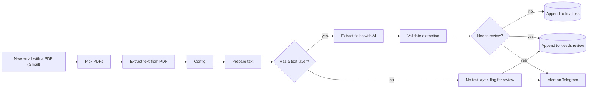

# 04 Invoice email to Sheets

Supplier invoices arrive as PDF attachments. This workflow reads each PDF, extracts the data with AI, checks it with code and writes one row per invoice into Google Sheets. Anything doubtful goes to a separate `Needs review` tab and pings you on Telegram, so nobody types invoice data by hand and nothing wrong slips in silently.

## What it does

1. **New email with a PDF** polls Gmail every 5 minutes for emails with a PDF attachment and downloads the attachments.
2. **Pick PDFs** creates one item per PDF (an email with three invoices gives three rows) and drops everything that is not a PDF.
3. **Extract text from PDF** reads the text layer. A corrupt or password-protected file does not stop the run; it is flagged later.
4. **Prepare text** puts the email details back next to the text, trims it to `max_chars` and checks that the PDF actually has text.
5. **Has a text layer?** Scanned PDFs (images only) skip the AI and go to review with the reason `No text layer`.
6. **Extract fields with AI** returns vendor name and tax ID, invoice number, invoice and due date, currency, subtotal, tax, total, IBAN, document type, line items and its own confidence. The prompt says to use `null` rather than guess, and works with invoices in any language.
7. **Validate extraction** is plain code. A row needs review when the AI call failed, the vendor, invoice number, date or total is missing or invalid, subtotal plus tax does not equal the total (within `amount_tolerance`), the model confidence is below 0.7, or the text was truncated.
8. Clean rows are appended to `Invoices`. Rows that need review go to `Needs review` together with the reason, and a Telegram message is sent.

## Credentials you need

| Node | Credential | Notes |
|---|---|---|
| New email with a PDF | Gmail OAuth2 | Another mailbox works with the Email Trigger (IMAP), see Customise |
| Extract fields with AI | OpenAI API (or compatible) | |
| Append to Invoices, Needs review | Google Sheets OAuth2 | |
| Alert: invoice needs review | Telegram API | |

## Config node

| Field | Default | Meaning |
|---|---|---|
| `model` | `gpt-4o-mini` | Chat model with JSON mode |
| `ai_base_url` | `https://api.openai.com/v1` | OpenAI-compatible API |
| `sheet_id` | `YOUR_GOOGLE_SHEET_ID` | Spreadsheet with the two tabs |
| `telegram_chat_id` | `YOUR_TELEGRAM_CHAT_ID` | Where review alerts go |
| `max_chars` | `15000` | Maximum text sent to the AI per PDF |
| `amount_tolerance` | `0.05` | Allowed difference between subtotal plus tax and total |
| `system_prompt` | long text | Extraction rules |

## Sheet

Create two tabs, `Invoices` and `Needs review`, both with the header row from [`sheets/invoices.csv`](sheets/invoices.csv):

`Received at, From, Subject, File, Vendor, Vendor tax ID, Invoice number, Invoice date, Due date, Currency, Subtotal, Tax, Total, IBAN, Document type, Line items, Confidence, Pages, Review reason`

`Line items` holds the lines as JSON text. Dates are ISO (`YYYY-MM-DD`) and amounts use a dot as decimal separator, so they sort and sum correctly in Sheets.

## Before you activate it

The default Gmail filter is `has:attachment filename:pdf`, which also catches newsletters, contracts and brochures. Narrow it to your invoice flow, for example a Gmail filter that applies a label, and use `label:invoices has:attachment filename:pdf` in the trigger. Edit the filter under the trigger's Filters option.

## Test it

Send yourself an email with a sample invoice PDF, open the workflow and use `Fetch test event` on the trigger, then step through the nodes. Also try a scanned PDF and an email with two attachments to see the review path and the one-row-per-PDF behaviour.

## Customise

- **IMAP instead of Gmail:** replace the trigger with Email Trigger (IMAP) and enable attachment download. In `Pick PDFs` adjust the sender line, which reads Gmail's `from` structure.
- **Scanned PDFs:** add an OCR step (for example a cloud OCR API, or a vision model) in front of `Prepare text` for items without text, and merge the result back into the same path.
- **Duplicates:** add a Google Sheets lookup on vendor plus invoice number before appending, and route matches to review.
- **Accounting software:** replace the Sheets nodes with your accounting tool's node or API call. Keep `Validate extraction` in front of it.
- **Currency or country rules:** add checks in `Validate extraction`, for example that the VAT ID matches a known supplier list.

## Limits

- This is a data-entry helper, not an accounting system. Spot-check rows, especially while you tune the prompt, and keep the review tab empty as a habit.
- Very long invoices are truncated at `max_chars`, which is flagged in the review reason.
- Invoices contain personal and commercial data that is sent to your AI provider. See the privacy notes in the main README.
