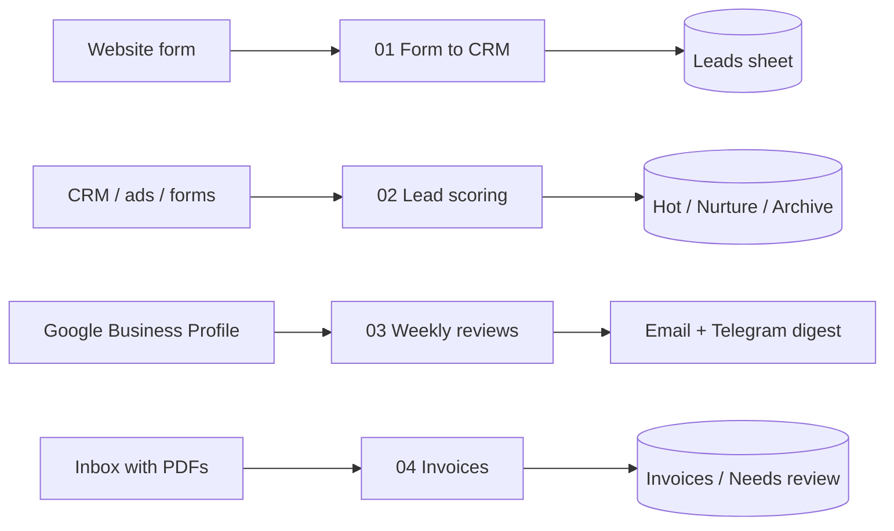

# n8n automation templates

Four production-minded n8n workflows for the automations small businesses and agencies ask for most: turning website enquiries into CRM rows with a personal reply, scoring and routing leads, summarising Google reviews every week, and getting invoices out of an inbox and into a spreadsheet.

Each template is a single importable `workflow.json` with its own README, a diagram, and the sheet headers it expects. No credentials are stored in any file.

| # | Template | Trigger | AI step | Result |
|---|---|---|---|---|
| 01 | [Website form to CRM with AI reply](01-website-form-to-crm-ai-reply) | Webhook from your site form | Drafts a personal reply in the sender's language and classifies the enquiry | Row in Google Sheets, Telegram or Slack alert, reply by email |
| 02 | [AI lead scoring and routing](02-ai-lead-scoring-and-routing) | Webhook from any CRM, ad platform or form | Scores the lead 0 to 100 against your ideal customer profile | Hot, warm and cold leads routed to different sheets, instant alert for hot leads |
| 03 | [Google reviews weekly AI summary](03-google-reviews-weekly-ai-summary) | Schedule, every Monday | Summarises themes, complaints and suggested actions | Digest by email and Telegram, weekly log in Sheets |
| 04 | [Invoice email to Sheets](04-invoice-email-to-sheets) | Gmail, new email with a PDF | Extracts vendor, number, dates, totals and line items | Clean rows in Sheets, doubtful ones flagged for review |



## How the templates are built

- **One Config node per workflow.** Model, sender address, sheet ID, chat IDs, thresholds and the AI system prompt all live in the first Set node called `Config`. You configure a workflow in one place instead of hunting through nodes.
- **No credentials in the files.** Nodes show a credential warning after import and you pick your own. The only values you will see are obvious placeholders such as `YOUR_GOOGLE_SHEET_ID`.
- **The AI is swappable.** AI calls use the HTTP Request node against the OpenAI-compatible `/chat/completions` endpoint in JSON mode. Change `ai_base_url` and `model` in Config to use another compatible provider (Azure OpenAI, Mistral, OpenRouter, a self-hosted gateway). The calls use the `OpenAI API` credential type; for a provider that needs another auth scheme, switch the node to a Header Auth credential.
- **Code does the maths, the AI does the language.** Tiers come from the score and your thresholds, review counts and averages are computed in a Code node, invoice totals are cross-checked in code. The model never decides anything a few lines of JavaScript can decide deterministically.
- **Inputs are treated as untrusted.** Form text, lead text, review text and PDF text are wrapped in markers and the prompts tell the model to ignore instructions inside them. Model output is parsed defensively and validated against allowed values.
- **Nothing gets lost when the AI fails.** The AI node continues on error and the next step falls back to safe defaults, so a lead is still saved and flagged, and an invoice goes to the review sheet.
- **Notification nodes are optional.** Telegram is wired in, Slack is included but disabled, and SMTP sends email. Enable, disable or replace them freely.

## Requirements

- n8n 1.x. The templates use current node versions (Edit Fields 3.4, If 2.2, Switch 3.2, HTTP Request 4.2), so a recent 1.x release is recommended (1.70 or newer). Both n8n Cloud and self-hosted work.
- An AI provider account with an OpenAI-compatible API.
- Depending on the template: Google account (Sheets, Gmail, Business Profile), Telegram bot, SMTP mailbox, Slack app.

## Import a template

In the n8n editor: **Workflows**, the menu next to **Create workflow**, **Import from file**, choose a `workflow.json`. Or on the command line:

```bash
n8n import:workflow --input=01-website-form-to-crm-ai-reply/workflow.json
```

Then open the workflow and:

1. Fill in the `Config` node.
2. Select credentials on every node that shows a warning.
3. Create the sheet tabs described in the template README and paste in the header row from its `sheets/` folder.
4. Run it once manually (webhook templates: use the test URL), check the output of each node, then activate.

After import, n8n node parameters can differ slightly between releases. If a node shows a parameter warning, open it and re-select the value; the rest of the workflow keeps working.

## Validate the exports

The repository includes an offline checker. It needs only Node.js 18 or newer and no n8n instance:

```bash
npm run validate
```

It checks that every `workflow.json` parses, node names and ids are unique, every connection points at a real node, every node is reachable from a trigger, no credentials or secret-looking strings are present, and that every `{{ expression }}` and every Code node compiles as JavaScript. It does not execute the workflows, so test each one in n8n with your own credentials before relying on it.

## Privacy and security notes

- Several templates send personal data (names, emails, message text, invoice contents) to your AI provider. Pick a provider and region that fit your obligations, sign a data processing agreement where needed, and mention it in your privacy notice. For EU data, check where the model runs.
- Protect your webhooks. Template 02 uses Header Auth. Template 01 is called from a browser, so it uses an allowed origin and a honeypot field instead of a secret; add a CAPTCHA or rate limiting at your proxy if the form is a spam target.
- The reply email in template 01 is sent automatically by default. Set `auto_send_reply` to `false` in Config if you want a human to read the AI draft first.
- Sheets are plain spreadsheets: restrict who can open them.

## Repository layout

```
01-website-form-to-crm-ai-reply/    workflow.json, README.md, sheets/leads.csv
02-ai-lead-scoring-and-routing/     workflow.json, README.md, sheets/scored-leads.csv
03-google-reviews-weekly-ai-summary/ workflow.json, README.md, sheets/weekly-log.csv
04-invoice-email-to-sheets/         workflow.json, README.md, sheets/invoices.csv
scripts/validate.mjs                offline checker
```

---

Built by [Vixon Lab](https://vixonlab.ro), a web studio for fast sites, AI chatbots and automations.
